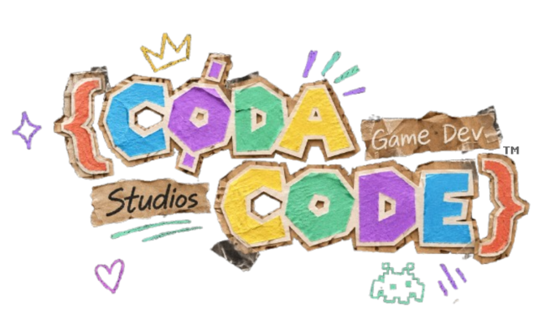

CodaCode Game Development Studios is a Video Game company founded by Harvey Widjaja in early 2026.
He then invited is friends to join, making it a classic indie dev team.

## General Information

|  |  |
| ----------------- | ----------------------------------------- |
| Company Type | Video Game Development |
| Subsidiaries | CodaCode Music, CodaCode Contracting |
| Protection Status | Common-Law Trademark, General Copyright |
| Specialties | Video Game Development, Music Composition |
| Published Games | N/A (None right now) |

## Early Beginnings

CodaCode Studios was created sometime in early 2026, of course, by Harvey.
At first, it was just a placeholder for his "games" that he had developed at the time. It soon then evolved into the indie dev team it is today, with his 7 friends on the team.

